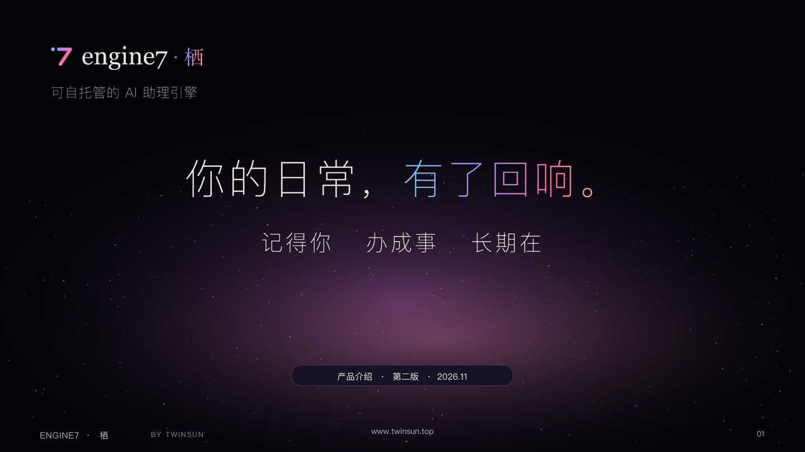

  

**English** | [中文](README.md)

# Engine7 · 栖 ("Qi")

**Remembers you · Gets things done · Stays around**

An AI companion that knows you, lives with you, and gets real work done. Engine7 is a self-hostable AI companion and agent engine that brings long-term memory, task execution, multi-channel access, and model choice together into your daily life.

This repository contains public product documents and user guides. The product introduction PDF is currently in Chinese; English documentation lives under [docs/en/](docs/en/).

[Website](https://engine7.ai/) · [Download](https://engine7.ai/download/) · [Product introduction (online)](https://engine7.ai/intro/) · [China mirror](https://www.twinsun.top/en/) · [Feedback](https://github.com/ruiyangruiyi/engine7-docs/issues)

## Start Here

| What you want | Where to go |
| --- | --- |
| What Engine7 can do | [Product overview](docs/en/overview.md) |
| First install and first run | [Quick start](docs/en/quick-start.md) |
| Watch progress, change direction, interrupt in time | [Interactive, interruptible tasks and commands](docs/en/interactive-tasks.md) |
| Switching models and configuring fallbacks | [Model choice and fallback](docs/en/models-and-fallback.md) |
| Common questions and troubleshooting | [FAQ](docs/en/faq.md) |
| Official product materials | [44-page product introduction PDF](materials/engine7-product-introduction.pdf) · [Deck PPTX](materials/engine7-product-introduction.pptx) (Chinese, 2026.11 edition) |

## You stay in the loop while it works

Hand a task over and still see the process. Work mode reports progress, tool activity, and intermediate results; whenever the direction drifts, you can add requirements or stop the current task.

| Command | When to use it |
| --- | --- |
| `/work on` | Focus the session on work tasks |
| `/ps Give me a two-page summary first, not the full text` | Task still running; add or adjust requirements right away |
| `/stop` | Stop the task currently executing in this session |
| `/model` | See available models, the current choice, and fallback-chain status |
| `/model auto` | Return to automatic selection and re-enable the configured fallback chain |

See the [interactive tasks guide](docs/en/interactive-tasks.md) for exact syntax and scope. Chat platforms may use text commands or native slash-command forms; what you see depends on the channel and settings.

## One more option, one more layer of availability

With a fallback model or service configured, Engine7 can try other candidates when a service fails, and it shows switching and cooldown status. You can also pick a configured model yourself with `/model`. Details in the [fallback guide](docs/en/models-and-fallback.md).

## Materials and feedback

This repository is the official public documentation entry point for Engine7. The current product introduction is the **2026.11 Chinese 44-page second edition**; the website and this repository carry the same official material — versions and update records are in the [CHANGELOG](CHANGELOG.md) (Chinese).

Please open [Issues](https://github.com/ruiyangruiyi/engine7-docs/issues) for usage problems or documentation suggestions. Include version, OS, channel, and reproduction steps, and strip keys and private conversations first. If this helps, a **Star** makes it easier to come back to.
