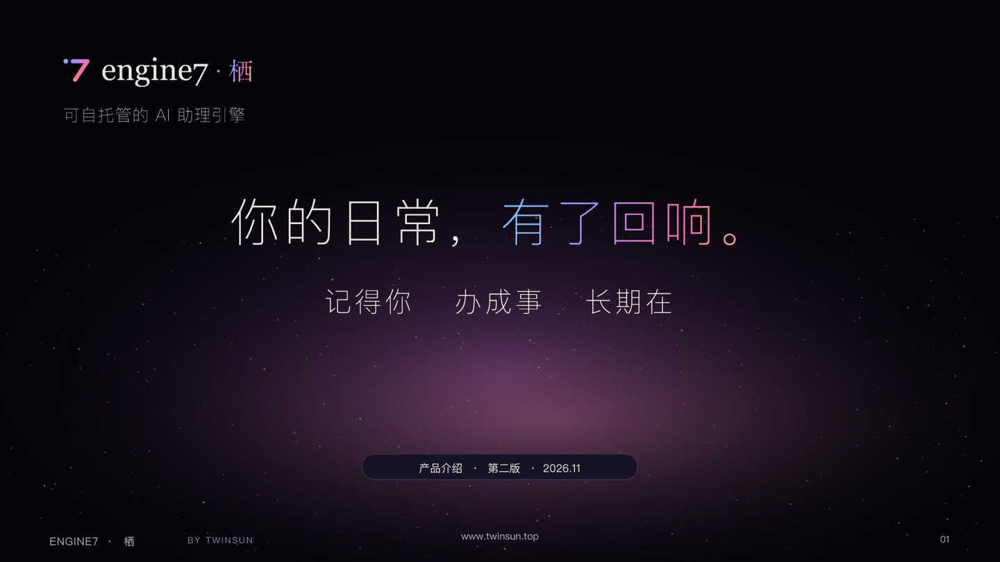

  

# Engine7 · 栖

**记得你 · 办成事 · 长期在**

一个记得你、与你相处，也能把事情做好的 AI 伙伴。Engine7 是可自托管的 AI 助理引擎，把长期记忆、任务执行、多渠道沟通和模型选择放在一起，进入你的日常。

Self-hosted AI companion and agent engine with persistent memory, interactive tasks, multi-channel access and model fallback. This repository contains public product documents and user guides, currently in Chinese.

[官网](https://www.twinsun.top/) · [下载安装](https://www.twinsun.top/download/) · [在线产品介绍](https://www.twinsun.top/intro/) · [使用反馈](https://github.com/ruiyangruiyi/engine7-docs/issues)

## 从这里开始

| 想了解什么 | 入口 |
| --- | --- |
| Engine7 能做什么 | [产品概览](docs/overview.md) |
| 第一次安装与使用 | [快速开始](docs/quick-start.md) |
| 看进展、改方向、及时打断 | [可交互、可干预的任务与命令](docs/interactive-tasks.md) |
| 切换模型与配置备用服务 | [模型选择与 Fallback](docs/models-and-fallback.md) |
| 常见问题与排查 | [FAQ](docs/faq.md) |
| 正式对外产品材料 | [44 页产品介绍 PDF](materials/engine7-product-introduction.pdf) · [演示文件 PPTX](materials/engine7-product-introduction.pptx) |

## 工作过程中，你始终能参与

任务交出去，过程也看得见。work 模式会输出工作进展、工具活动和中间结果；发现方向偏了，可以随时补充要求或停止当前任务。

| 命令 | 什么时候用 |
| --- | --- |
| `/work on` | 接下来需要专注处理工作任务 |
| `/ps 请先做两页摘要，先不要展开全文` | 当前任务还在运行，马上补充或调整要求 |
| `/stop` | 停止当前会话正在执行的任务 |
| `/model` | 查看可用模型，以及当前选择与备用链状态 |
| `/model auto` | 恢复自动选择，重新启用配置中的备用链 |

具体语法及执行范围见[交互说明](docs/interactive-tasks.md)。聊天平台可能使用文本命令或原生斜杠命令表单；显示内容取决于渠道与设置。

## 多一个选择，多一份可用性

配置备用模型或服务后，Engine7 可在服务异常时尝试其他候选项，并显示切换与冷却状态。你也可以用 `/model` 主动选择已配置的模型。详情见 [Fallback 使用说明](docs/models-and-fallback.md)。

## 产品材料与反馈

本仓是 Engine7 的官方公开文档入口，现阶段发布产品介绍和使用说明。当前产品介绍为 **2026.11 中文 44 页第二版**；官网与本仓提供同一份正式材料，版本与更新记录见 [CHANGELOG](CHANGELOG.md)。

欢迎通过 [Issues](https://github.com/ruiyangruiyi/engine7-docs/issues) 提交使用问题或文档建议。反馈时请提供版本、系统、渠道和复现步骤，并先去掉密钥及私人对话。觉得有帮助，可以点一个 **Star**，方便以后回来查看。
